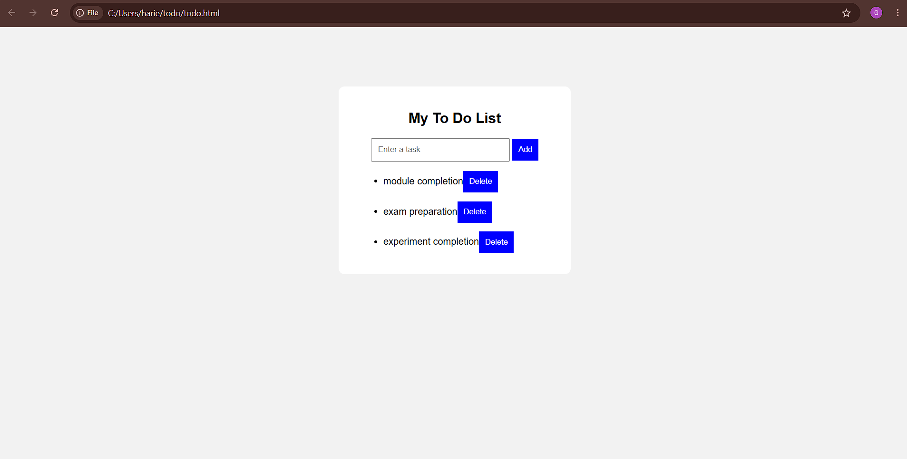

# Ex03 To-Do List using JavaScript
<<<<<<< HEAD
# Date:17-11-2026
=======
## Date:

>>>>>>> d5de6ef4690904fce9e43e13407ab03d1af9add1
## AIM
To create a To-do Application with all features using JavaScript.

## ALGORITHM
### STEP 1
Build the HTML structure (index.html).

### STEP 2
Style the App (style.css).

### STEP 3
Plan the features the To-Do App should have.

### STEP 4
Create a To-do application using Javascript.

### STEP 5
Add functionalities.

### STEP 6
Test the App.

### STEP 7
Open the HTML file in a browser to check layout and functionality.

### STEP 8
Fix styling issues and refine content placement.

### STEP 9
Deploy the website.

### STEP 10
Upload to GitHub Pages for free hosting.

## PROGRAM
<<<<<<< HEAD
```

<!DOCTYPE html>
<html>
<head>
    <title>To Do List</title>

    <style>
        body {
            font-family: Arial;
            text-align: center;
            background: #f2f2f2;
        }

        .container {
            background: white;
            width: 350px;
            margin: 100px auto;
            padding: 20px;
            border-radius: 10px;
        }

        input {
            padding: 10px;
            width: 60%;
        }

        button {
            padding: 10px;
            background: blue;
            color: white;
            border: none;
            cursor: pointer;
        }

        li {
            margin: 15px;
            text-align: left;
        }

        .completed {
            text-decoration: line-through;
            color: gray;
        }
    </style>
</head>

<body>

<div class="container">

    <h2>My To Do List</h2>

    <input type="text" id="task"
    placeholder="Enter a task">

    <button onclick="addTask()">Add</button>

    <ul id="taskList"></ul>

</div>

<script>

function addTask() {

    let input = document.getElementById("task");
    let value = input.value.trim();

    if (value === "") {
        alert("Enter a task");
        return;
    }

    let li = document.createElement("li");

    li.textContent = value;

    li.onclick = function() {
        li.classList.toggle("completed");
    };

    let btn = document.createElement("button");

    btn.textContent = "Delete";

    btn.onclick = function(event) {
        event.stopPropagation();
        li.remove();
    };

    li.appendChild(btn);

    document.getElementById("taskList")
    .appendChild(li);

    input.value = "";
}

</script>

</body>
</html>

```

## OUTPUT


## RESULT
The program for creating To-do list using JavaScript is executed successfully.
=======


## OUTPUT


## RESULT
The program for creating To-do list using JavaScript is executed successfully.
>>>>>>> d5de6ef4690904fce9e43e13407ab03d1af9add1
